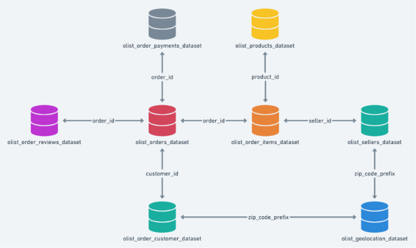

# E-commerce-Sales-Operations-Analysis: SQL Case Study

SQL analysis of Target's e-commerce operations in Brazil (2016–2018), covering order trends, customer distribution, revenue, freight, delivery performance and payment behaviour. The goal is to turn raw order data into actionable business recommendations.

**Tool used:** MySQL

---

## Business Questions Answered

- How have orders grown over the years, and is there monthly or time-of-day seasonality?
- Which states have the most customers and orders?
- How do price and freight value vary by state and year?
- How does actual delivery time compare with the estimated date, and which states are fastest or slowest?
- Which payment types and installment plans do customers prefer?

---

## Dataset

The dataset has 8 tables covering about 100,000 orders placed in Brazil between 2016 and 2018 (Olist public e-commerce data, shared as part of the Target case study).

| Table | Description |
|---|---|
| `customers` | Customer ID, city, state, zip code prefix |
| `orders` | Order status and purchase, approval, delivery and estimated delivery timestamps |
| `order_items` | Products in each order, seller, price and freight value |
| `payments` | Payment type, installments and payment value |
| `order_reviews` | Review scores and comments |
| `products` | Product category and dimensions |
| `sellers` | Seller location details |
| `geolocation` | Zip code prefix with latitude and longitude |

### Schema

---

## Key Insights and Recommendations

1. **Orders grew strongly from 2016 to 2018 but fell sharply at the end of the data.** September and October 2018 show steep drops. These are the last months in the dataset, so data completeness should be checked before concluding that business actually declined.
2. **Peak ordering time is 6 PM to 11:59 PM, about 41% of all orders.** Low-volume categories such as food, fashion and men's clothing could be promoted during these hours.
3. **SP, RJ and MG generate 63.37% of revenue, with SP alone at 38.28%.** Retain customers in these markets, and run targeted promotions in growing markets such as RS, PR, SC and BA.
4. **RR, PB, RO and AC have the highest average freight costs and long delivery times.** Review logistics in these states: shipping routes, delivery partners and fulfilment locations.
5. **84.69% of orders use five or fewer installments.** Work with financing partners to offer more affordable plans on higher-value purchases.
6. **14.20% of reviewed orders scored below 3 stars, and low ratings are linked to longer delivery times.** Improving delivery performance should lift ratings.

Full details are in [`SQL_PROJECT.pdf`](SQL_PROJECT.pdf).

---

## SQL Concepts Used

Joins across multiple tables, aggregate functions, `GROUP BY` / `HAVING`, `CASE WHEN`, date functions (`EXTRACT`, `YEAR`, `MONTH`, `DATEDIFF`), subqueries, `information_schema`.
